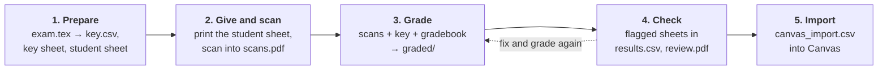

# omr_grader

Grades scanned 100-question bubble sheets (the `Sheet100QA4.pdf` layout in this repo).

OMR (optical mark recognition) reads marks made in known places on a printed form. The
grader lines up each scan using the black corner squares, then measures how dark each
answer, Student ID and Key bubble is. It needs no character recognition, except for the
optional reading of handwritten ID digits (see [Digit reader](#digit-reader)).

[docs/GUIDE.md](docs/GUIDE.md) walks through one exam from the key to the Canvas
import, with example output and what to do about each flag.

## Install

The grader runs on your own computer, so scans and gradebooks are never uploaded. It
needs git (on a Mac, typing `git` in Terminal offers to install it) and has been tested
on macOS.

### With uv (recommended; no Python needed)

[uv](https://docs.astral.sh/uv/) installs Python programs, and Python itself if needed,
in their own folder, so the grader can't conflict with other Python software.

1. Install uv. On a Mac or Linux, in Terminal:

   ```bash
   curl -LsSf https://astral.sh/uv/install.sh | sh
   ```

   On Windows, in PowerShell:

   ```powershell
   powershell -ExecutionPolicy ByPass -c "irm https://astral.sh/uv/install.ps1 | iex"
   ```

   Then close the terminal and open a new one.

2. Install the grader:

   ```bash
   uv tool install git+https://github.com/eraldoribeiro/omr_grader.git
   ```

3. Open the grader window in your browser:

   ```bash
   omr-grader-gui
   ```

   The same steps from the command line: `omr-grader --help`.

To update, run step 2 again with `--reinstall` after `install`. To remove it:
`uv tool uninstall omr-grader`.

### With pip (if you already use Python, e.g. Anaconda)

Install it in its own environment. Installing into Anaconda's `base` adds Gradio and
several dozen packages it needs, and can upgrade packages other projects rely on. With
conda:

1. Create the environment (once):

   ```bash
   conda create -n omr python=3.12
   ```

2. Keep out Python packages installed in your user folder (`~/.local`), which every
   conda environment otherwise sees and which can conflict with the grader's (once):

   ```bash
   conda env config vars set PYTHONNOUSERSITE=1 -n omr
   ```

3. Activate it:

   ```bash
   conda activate omr
   ```

4. Install the grader into it:

   ```bash
   pip install git+https://github.com/eraldoribeiro/omr_grader.git
   ```

This adds the same two commands, available while the environment is active: run
`conda activate omr` in each new terminal before using them. To update, run step 4 again
with `--force-reinstall --no-deps` after `install`. To remove it, delete the environment:
`conda remove -n omr --all`.

### From a clone (to try the example exam or change the code)

```bash
git clone https://github.com/eraldoribeiro/omr_grader.git
```

In the clone, `python omr_grader.py` and `python gui.py` do the same as the two commands;
they need `opencv-python`, `numpy`, `pymupdf` and, for the window, `gradio`. The example
exam in `example/` is only in a clone (see [Testing](#testing)). The examples below use
`python omr_grader.py`; with an installed copy type `omr-grader` instead.

## Workflow



Typical use for one exam:

```bash
# 1. Before the exam: the key from the LaTeX, a key sheet to check, the sheet to print
python omr_grader.py --key exam2.tex --key-id 322 --exam-name "Exam 2" \
    --course "CSE4001 Fall 2026" --key-sheet exam2/key_sheet.pdf \
    --student-sheet exam2/student_sheet.pdf --out exam2

# 2. After the exam: grade the scans and fill the Canvas gradebook column
python omr_grader.py exam2/scans.pdf --key exam2/key.csv \
    --canvas exam2/gradebook.csv --canvas-assignment "Exam 2"
```

The results go to `exam2/graded`, next to the scans (`--out` picks another folder).
Step 2 without `--canvas` only grades. Check the `flags` column of
`exam2/graded/results.csv` and the flagged pages of `review.pdf`, then import
`exam2/graded/canvas_import.csv` in Canvas (Grades > Import).

The same steps in a browser form, without typing options:

```bash
python gui.py
```

Set "Exam folder" at the top to `exam2`. Then:

1. **Prepare exam** tab: add the exam `.tex` (and its `.aux`), enter the key ID, exam
   name and course, and click "Make key and sheets". The key and sheets are written to
   the exam folder. Check the key it shows.
2. **Grade** tab: add the scans, the key and the gradebook, pick the assignment column,
   and click "Grade". The results go to `exam2/graded`.
3. **Review** tab: go through the flagged sheets, click the bubbles the grader missed,
   and click "Save and grade again". Then import `canvas_import.csv` from
   `exam2/graded`.

See [Local window](#local-window) for details.

- **Scans**: PDFs (one sheet per page) or images. Pages may be skewed, upside down or
  sideways (landscape pages are turned upright before grading).
- **Key**: the exam's LaTeX file (below), a CSV with lines `version,answers`
  (e.g. `322,ABCDDCBA...`; the version `any` grades every sheet), or a filled key sheet
  scanned as PDF/image (one page per version; the Key bubbles give the version).
  Repeat `--key` to combine several.
- **Key from the exam LaTeX**: pass the `.tex` file itself (exam class; the answer is
  the `\correctchoice` / `\CorrectChoice`). Questions are numbered in document order,
  skipping commented lines and code listings, and the count is checked against the
  `.aux` file. A question with no correct choice, several, or one past D is canceled
  with a warning. Without a version prefix the key grades every sheet; for several
  versions use `--key 322=exam_a.tex --key 117=exam_b.tex`. To check the key before
  the exam, run with no scans: `python omr_grader.py --key exam.tex --out exam2` writes
  only `exam2/key.csv`.
- **Canceled questions**: on a key sheet, leave the question blank or fill all its bubbles.
  A blank at the very end of the key shortens it, so pass `--num-questions` to keep
  it. In a CSV key use `X`, `-` or `*`. You can also cancel from the command line:
  `--cancel 5,12` (all versions) or `--cancel 322:5,117:9`. By default canceled
  questions are left out of the total (`--canceled drop`); `--canceled credit` gives
  everyone the point.
- **Student ID**: 4 digits by default (the sheet asks for the last 4 digits of the
  student number). The 4-digit sheet prints its ID columns where the old 6-column sheet
  had columns 3-6, so the digits are read from the right-hand columns. For an old
  6-column sheet use `--id-digits 6`. Marks to the left of the ID columns are flagged.
- **Handwritten ID**: when an ID column has no bubble marked, the digit written in the
  box above it is read instead, if the digit reader is at least 90% sure. Every such ID
  is flagged (`ID from handwriting, check`) and the enlarged boxes are shown at the
  bottom of its `review.pdf` page; unclear digits stay `?` with a guess in the flags, and
  handwriting that disagrees with the bubbles is flagged too. On synthetic scans, 95% of
  digits were read right, 4% were left as `?` and about 1% were misread. Turn it off
  with `--no-handwriting`.
- **Corrections**: `--corrections corrections.csv` sets answers, IDs or versions by
  hand, for very light or missing marks and IDs the grader could not match. Each line is
  `page,question,answer` with the page label from `results.csv`: `scans.pdf#p2,5,C`
  sets Q5 to C, `-` clears a stray mark, `scans.pdf#p6,id,3041` sets the ID (the full SIS
  User ID tells apart two students who share the last digits), and
  `scans.pdf#p6,version,322` sets the version. The scans are not changed; each correction
  is flagged in `results.csv` and marked `HAND` on `review.pdf`, where the sheet's score
  line becomes two: as read, and corrected.
- The 3-digit Key field on each student sheet selects which answer key grades it
  (except a `.tex` key given without a version, which grades every sheet).
- The number of questions graded is the key length unless `--num-questions` is given.

Outputs in `--out` (default: a `graded` folder next to the first scan):

- `key.csv`: the key used for grading, after cancellations.
- `results.csv`: one row per page: student ID (and, with `--canvas`, name and SIS User
  ID), version, score, total, percent, the answers read (`-` blank, `*` multiple marks),
  and flags: blanks, faint and multiple marks, ID problems, gradebook matching and
  corrections. The guide lists every flag and what to do about it.
- `item_analysis.csv`: percent correct per question and version.
- `review.pdf`: each sheet aligned, correct answers circled in green, wrong choices
  crossed in red, blanks and multiple marks labelled, canceled questions struck through,
  and answers set from the corrections file marked `HAND`. The score is at the bottom;
  a corrected sheet shows two lines, as read and corrected.
- With `--canvas`: `canvas_import.csv` and `absent.csv` (see
  [Canvas gradebook](#canvas-gradebook)).

A bubble counts as marked when its inner darkness is at least `MARK_T` (0.35) and at least
`RELATIVE_T` (0.6) of the darkest bubble in the same row, so light erasures are ignored.
To pick up lighter marks, lower the threshold with `--mark-threshold 0.25`. On the test
sheets empty bubbles read about 0.02, an erased mark about 0.2 and pencil marks 0.5 or more,
so going below about 0.22 risks counting an erased-and-left-empty question as answered.
A question read as blank whose darkest bubble is still above half the threshold is
flagged `faint mark, check` so you can look at it in `review.pdf`.

## Canvas gradebook

Export the gradebook from Canvas (Grades > Export > CSV) and pass it with the assignment
to fill:

```bash
python omr_grader.py exam2/scans.pdf --key exam2/key.csv \
    --canvas exam2/gradebook.csv --canvas-assignment "Exam 2"
```

- Each sheet's ID is matched to the last digits (`--id-digits`, default 4) of a
  student's **SIS User ID**, the university student number. The name and SIS User ID are
  added to `results.csv`.
- The gradebook also repairs IDs, always flagged: an ID with unreadable digits (`47?1`)
  is completed when exactly one student fits, and when the bubbled ID matches nobody but
  the handwritten one does, the handwritten one is used.
- Not exported, flagged in `results.csv`: IDs matching no student, IDs shared by two
  students in the class (also warned at startup), and students with more than one sheet.
- `canvas_import.csv`: the identity columns plus the assignment column, one row per
  matched student, score scaled to the assignment's points possible. Import it with
  Grades > Import. Students not in the file keep their current Canvas grade.
- `absent.csv`: students in the gradebook with no sheet.

The gradebook holds student names and IDs, so keep it out of the repo (the `.gitignore`
already does).

## Printable sheets

The blank template has no course, exam or key filled in, so it works for any course.
The grader can fill it in for you:

```bash
python omr_grader.py --key exam.tex --key-id 322 --exam-name "Exam 2" \
    --course "CSE4001 Fall 2026" --key-sheet key_sheet.pdf --student-sheet student_sheet.pdf
```

- `--key-sheet`: the answer key bubbled in, with "ANSWER KEY" as the name, for checking
  the key by hand or grading by hand. Canceled questions have all four bubbles filled.
  The file can be given back to the grader as `--key key_sheet.pdf`.
- `--student-sheet`: the sheet to print for students, with the exam name, course and
  key ID filled in and no answers.
- `--key-id` is the 3-digit ID bubbled in the Key field. A `.tex` key needs it (or
  `322=exam.tex`); CSV and scanned keys carry their own. Several versions give one page
  each.
- `--template` picks a different blank sheet; the default is the `Sheet100QA4.pdf`
  that comes with the grader (`omrgrader/` in the repo).

Without scans, only these files and `key.csv` are written.

## Local window

`omr-grader-gui` (or `python gui.py` in a clone) puts the same steps in a form that
opens in your browser, in Gradio's dark theme:

```bash
omr-grader-gui
```

The "Exam folder" at the top applies to every tab: Prepare exam writes the key and
sheets into it, grading writes to its `graded` folder, and Review reads from there and
writes `corrections.csv` into the exam folder. It starts as the folder the
window was started from (in Finder, Option-Command-C copies a folder's path to paste
in). The header links to [docs/GUIDE.md](docs/GUIDE.md), which shows each step both in
the window and on the command line.

- **Grade** tab: add the scans and the key (the exam `.tex`, with its `.aux` for the
  question-count check, a key CSV or a scanned key sheet), optionally the Canvas
  gradebook (its assignment columns fill the dropdown), a corrections file and
  cancellations. After grading it shows a summary, the sheets to check and all sheets,
  with buttons that open `review.pdf` and the `graded` folder.
- **Review** tab: after grading, shows the sheets with flags. Click the bubble the student
  meant to set that answer, or the question number to clear a stray mark (click again to
  undo), and type an ID or version for sheets that need one. "Save corrections" writes
  `corrections.csv` in the exam folder, and the Grade tab applies that file whenever its
  Corrections box is empty; "Save and grade again" does both, and the corrected answers
  show up marked `HAND`.
- **Prepare exam** tab: the key, key sheet and student sheet from the LaTeX or a CSV,
  with the key shown ten questions per line for checking.
- "More options" holds the mark threshold, number of questions, ID digits and the
  handwritten-ID switch. The grader's output, starting with the equivalent command line,
  is under "Grader output".

The page is served only to this computer (`127.0.0.1`), with no share link and Gradio's
usage statistics off. Each run copies the uploads to a temporary folder deleted when the
run ends. Gradio's own copies of uploads (in the system temporary folder) are deleted
after 4 hours while it runs (long enough to review and grade again in one sitting), and
all of them the next time the window starts. Results are written to the exam folder.

## Digit reader

`omrgrader/handwriting.py` reads the ID boxes with a small CNN (two convolution layers
and two fully connected layers). PyTorch is used only to train it; the trained weights
are saved in `digits_model.npz` (about 200 KB), and the grader runs the network in
NumPy: the convolutions, max-pooling, matrix products and softmax take about fifteen
lines. On the test digits the NumPy and PyTorch outputs agree to within 1e-6.

Running the network in NumPy keeps grading free of a deep-learning library:

- PyTorch is about 330 MB installed and is not part of a standard Anaconda `base`
  environment; NumPy is already needed for the image processing.
- PyTorch builds are tied to particular Python versions and hardware, which makes it the
  install most likely to fail on another machine (a TA's laptop, another course).
- An upgrade of a large library cannot change or break how a digit is read.
- Importing PyTorch would add a second or two to every run, for four digits per sheet.

Grading needs only OpenCV, NumPy and PyMuPDF, and the weights file in this repo.

The network itself is written out in `omrgrader/handwriting.py`; the weights file holds
only the learned numbers:

- `_conv`: a convolution layer (each 3x3 filter slid over the image with NumPy's
  `sliding_window_view` and `einsum`, plus the bias).
- `_pool`: 2x2 max-pooling (reshape into 2x2 blocks, keep each block's maximum).
- `DigitReader` loads the weights with `np.load`; its `probs` method chains the layers
  (convolution, ReLU, pooling, twice; then two matrix products and a softmax) and returns
  the ten digit probabilities.
- `DigitReader.read` is what the grader calls: for each ID box it cuts the box out,
  cleans it, runs `probs`, and returns the likeliest digit and its confidence.

The same network is defined in PyTorch in `make_model` in `train_digits.py`, for
training. The two definitions must match layer for layer, or the saved weights would be
read into the wrong layers, so `train_digits.py` checks after saving that the NumPy
version gives the same probabilities as PyTorch.

To retrain the weights (needs PyTorch and the MNIST idx files):

```bash
python train_digits.py path/to/MNIST/raw
```

Training pastes MNIST digits into simulated scanned boxes (box lines, blur, noise,
digits too big or off-center) and runs them through the same clean-up as real boxes.

## Testing

`example/` holds a made-up exam with no real students: `exam.tex` (20 questions, laid
out like a real two-column exam, with a commented-out question and a canceled one), its
`exam.aux` and `exam.pdf`, and `gradebook.csv`, a Canvas export with invented students.
`make_test_sheets.py --key` fills six sheets with answers to the exam's key, so the
whole workflow runs from the LaTeX to the Canvas import:

```bash
python omr_grader.py --key example/exam.tex --key-id 322 --exam-name "Exam 1" \
    --course "Example 101" --key-sheet example/out/key_sheet.pdf \
    --student-sheet example/out/student_sheet.pdf --out example/out
python make_test_sheets.py --key example/out/key.csv example/out
python omr_grader.py example/out/students.pdf --key example/out/key.csv \
    --canvas example/gradebook.csv --canvas-assignment "Exam 1"
```

`example/out/graded/results.csv` should match `example/out/truth.csv`. The sheets are
skewed and noisy, and include a blank (sheet 2, Q5), a double mark (sheet 3, Q7), an
erased-and-changed answer (sheet 4, Q9) and an upside-down page (5). The student IDs
match the gradebook; one of them is shared by two students, so that sheet is held back.
Grading again with `--corrections example/corrections.csv` fixes sheet 2's blank Q5,
sheet 3's double mark and the shared ID. `example/out` is not tracked.

Without `--key`, `make_test_sheets.py [TEMPLATE.pdf] OUTDIR` makes up two 40-question
versions and also writes `keys.csv` and a filled key sheet (`--key key_sheet.pdf`):

```bash
python make_test_sheets.py test
python omr_grader.py test/students.pdf --key test/keys.csv
```

## License

MIT, see [LICENSE](LICENSE). The license covers this repository's code, docs, template
and model weights. The packages the grader installs have their own licenses: NumPy
(BSD), OpenCV (Apache 2.0), Gradio (Apache 2.0) and PyMuPDF (AGPL-3.0, or a commercial
license from Artifex). Using them as installed dependencies is fine; anyone who
distributes the grader bundled together with PyMuPDF, for example as a standalone app,
has to follow the AGPL for that bundle.

The digit reader's weights (`omrgrader/digits_model.npz`) were trained on the MNIST
handwritten digits, which are distributed under CC BY-SA 3.0.
