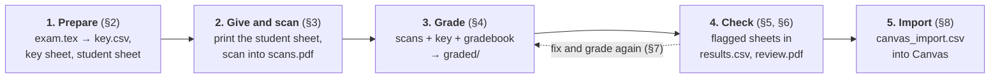
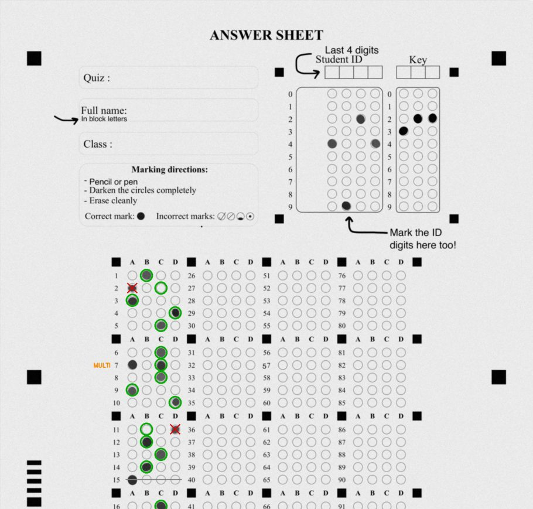

# Grading an exam with omr_grader

This guide follows one exam from the answer key to the Canvas gradebook, with the
commands, what they print, and what to do with each kind of flagged sheet. The
[README](../README.md) is the reference for every option.

The grader uses OMR (optical mark recognition): it reads marks made in known places on
a printed form. It lines up each scan using the black corner squares, then measures how
dark each answer, Student ID and Key bubble is. Handwritten ID digits, read only when
the ID bubbles are blank, are the one place it recognizes characters, and those reads
are always flagged for checking.

The steps, and the sections of this guide that cover them:



Each step is shown on the command line and in the window (`omr-grader-gui`). Both run
the same grader, and the window shows the equivalent command under "Grader output".
The examples use `omr-grader`, the installed command; in a clone of the repository,
type `python omr_grader.py` instead.

Contents:

1. [Set up a folder for the exam](#1-set-up-a-folder-for-the-exam)
2. [Before the exam: the key and the sheets](#2-before-the-exam-the-key-and-the-sheets)
3. [Scan the sheets](#3-scan-the-sheets)
4. [Grade](#4-grade)
5. [Read the results](#5-read-the-results)
6. [Flags and what to do about them](#6-flags-and-what-to-do-about-them)
7. [Fix and grade again](#7-fix-and-grade-again)
8. [Import into Canvas](#8-import-into-canvas)
9. [Practice on test sheets](#9-practice-on-test-sheets)

## 1. Set up a folder for the exam

Keep everything for one exam in one folder on your own computer:

```text
exam2/
  exam2.tex        the exam (LaTeX, exam class)
  exam2.aux        written by LaTeX; used to check the question count
  gradebook.csv    Canvas export (Grades > Export > CSV), for step 4
  scans.pdf        the scanned sheets, after the exam
```

The scans and the gradebook hold student names and IDs, so keep this folder off shared
drives and out of git. The grader never sends anything over the network, and the window
is served only to your own computer.

## 2. Before the exam: the key and the sheets

### The key from the LaTeX

The grader reads the correct answers from the exam source. Questions are numbered in
document order and the answer is the choice marked `\correctchoice` (or
`\CorrectChoice`):

```latex
\question Which system call creates a new process?
\begin{choices}
  \choice exec
  \correctchoice fork
  \choice wait
  \choice exit
\end{choices}
```

Choose a 3-digit key ID for this exam (students bubble it in the Key field; here 322)
and make the key and both printable sheets in one step:

```bash
cd exam2
omr-grader --key exam2.tex --key-id 322 --exam-name "Exam 2" \
    --course "CSE4001 Fall 2026" --key-sheet key_sheet.pdf \
    --student-sheet student_sheet.pdf --out .
```

For the example exam in the repository (section 9) it prints:

```text
warning: exam.tex: Q15: no correct choices, canceled
grading 20 questions; canceled questions are left out of the total
  key 322: canceled [15]
wrote key_sheet.pdf
wrote student_sheet.pdf
wrote key.csv
```

- `key.csv` is the key in plain text (`322,BCADCCCCADBBCBXCABBC`, with `X` for the
  canceled Q15). The grading step uses it.
- `key_sheet.pdf` is the answer sheet with the key bubbled in. Compare it with the exam
  to catch a wrong `\correctchoice` before grading.
- `student_sheet.pdf` is the blank sheet to print, with the exam name, course and key
  ID filled in.

Warnings to look for in the output:

- `found 18 questions but exam.aux says 20`: a question was skipped or counted twice,
  often one inside a comment or a code listing. Compile the LaTeX again and check.
- A question with no correct choice, or more than one, is canceled with a warning and
  shows as `canceled [n]`, like Q15 above.

In the window: set "Exam folder" at the top to the `exam2` folder (in Finder,
Option-Command-C copies a folder's path). Then, in the **Prepare exam** tab, add
`exam2.tex` and `exam2.aux`, type the key ID, exam name and course, keep both sheet
boxes ticked, and click "Make key and sheets". The key and sheets are written to the
exam folder, and the key appears ten questions per line for checking.

### Several versions

Give each version its own key ID:

```bash
omr-grader --key 322=exam2_a.tex --key 117=exam2_b.tex --exam-name "Exam 2" \
    --course "CSE4001 Fall 2026" --key-sheet key_sheet.pdf \
    --student-sheet student_sheet.pdf --out .
```

Each PDF then has one page per version, and `key.csv` one line per version. When
grading, each sheet is graded with the key whose ID the student bubbled.

### Without LaTeX

- **A key CSV written by hand**, one line per version; `X` cancels a question:

  ```text
  version,answers
  322,BCADCCCCADBBCBXCABBC
  ```

- **A filled key sheet**: bubble the answers and the Key ID on a blank sheet, scan it,
  and give the scan as the key (`--key key_scan.pdf`). Leave a question blank or fill
  all four bubbles to cancel it.

## 3. Scan the sheets

- Put all sheets in one PDF, one sheet per page (several PDFs also work).
- 200 to 300 dpi, grayscale or black and white.
- Page order and orientation don't matter: crooked pages are straightened, and
  upside-down and sideways (landscape) pages are turned upright.
- The six black corner squares must be on the page, so don't crop the edges.
- Scan the sheets as they are. Students who wrote their ID in the boxes without
  bubbling it are handled in step 6.

## 4. Grade

```bash
omr-grader scans.pdf --key key.csv \
    --canvas gradebook.csv --canvas-assignment "Exam 2"
```

The results go to a `graded` folder next to the scans, here `exam2/graded`; `--out`
picks another folder. Leave out the last line to grade without the gradebook. The output
for the example in section 9 (its gradebook column is "Exam 1"):

```text
gradebook: 9 students; column 'Exam 1 (100002)' (100 points)
  warning: Fontaine, Leo, Grady, Nora share ID digits 3040; their sheets cannot be matched automatically
grading 20 questions; canceled questions are left out of the total
  key 322: canceled [15]
students.pdf#p1: ID 2869  Archer, Maya  v322  14/19  73.7%
students.pdf#p2: ID 0621  Brennan, Theo  v322  10/19  52.6%  [blank: [5]]
students.pdf#p3: ID 4924  Castillo, Ines  v322  15/19  78.9%  [multiple: [7]]
students.pdf#p4: ID 3448  Dalton, Reid  v322  16/19  84.2%
students.pdf#p5: ID 8213  Ekwueme, Ada  v322  15/19  78.9%
students.pdf#p6: ID 3040  v322  15/19  78.9%  [ID 3040 belongs to 2 students (Fontaine, Leo; Grady, Nora); enter this grade by hand]
canvas: 5 grades in graded/canvas_import.csv; 1 sheet(s) not matched, 0 student(s) with several sheets (see flags); 4 student(s) without a sheet (graded/absent.csv)
wrote graded/results.csv, graded/item_analysis.csv, graded/review.pdf
```

Check the first lines:

- The gradebook line names the column that will be filled and its points. If the
  column name is wrong, the grader stops and lists the assignments it found.
- A `share ID digits` warning means two students in the class have the same last four
  digits. Their sheets are never matched automatically; enter those grades by hand.
- The key lines say how many questions are graded and which are canceled.

In the window: **Grade** tab, with the same exam folder at the top. Add `scans.pdf`,
`key.csv` and `gradebook.csv`, pick "Exam 2" in the column dropdown (it lists the
gradebook's assignments), and click "Grade". The results go to `exam2/graded`. The
summary shows the mean, median and range, then the sheets to check and all sheets.
Leave the "Corrections" box empty: after checking the flagged sheets, you can set
answers and IDs by clicking in the Review tab (section 7).

## 5. Read the results

Everything is written to `graded/` in the exam folder.

### results.csv

One row per page:

```text
page,student_id,name,sis_user_id,version,score,total,percent,answers,flags
students.pdf#p1,2869,"Archer, Maya",900112869,322,14,19,73.7,BCADCACCBDDBBBACACBC,
students.pdf#p2,0621,"Brennan, Theo",900120621,322,10,19,52.6,BCDD-DCBCDABDBAACBBC,blank: [5]
students.pdf#p3,4924,"Castillo, Ines",900134924,322,15,19,78.9,BAADCC*CADDBCBACCBBC,multiple: [7]
```

- `answers` is what was read: a letter, `-` for blank, `*` for several marks.
- `total` is the number of questions that count; canceled questions are left out
  unless you grade with `--canceled credit`.
- `name` and `sis_user_id` are there only with `--canvas`.
- `flags` is empty when there is nothing to check. Section 6 lists every flag.

Open it in Excel or Numbers and sort by `flags` to see the sheets to check together.

### review.pdf

One page per sheet, straightened, in the same order as `results.csv`:



- Green circle: the correct answer (filled in when the student chose it).
- Red cross: the student's wrong choice.
- `BLANK` and `MULTI` in orange, left of the question number.
- A line through a question: canceled (Q15 here).
- `HAND` in purple, with a box around the answer: an answer set from the corrections
  file (section 7).
- At the bottom of the page: ID, name, version and score, as in the console output.
- When the ID came from handwriting or the gradebook had to repair it, the enlarged ID
  boxes are pasted at the bottom so you can read them yourself.

Look at every page that has a flag. The first time you use a new scanner, scroll
through the other pages too.

### item_analysis.csv

The percentage of students who got each question right, per version:

```text
version,question,key,percent_correct
322,1,B,83.3
322,2,C,83.3
322,3,A,50.0
```

When almost nobody got a question right, check its key and its wording. Section 7
shows how to cancel it.

### canvas_import.csv and absent.csv

With `--canvas`, `canvas_import.csv` is the file you import (section 8). It has one row
per student whose sheet was matched, with the score scaled to the assignment's points:
14/19 on a 100-point assignment becomes 73.68.

`absent.csv` lists the students in the gradebook with no sheet: absent, or a sheet that
could not be matched. Compare it with the sheets flagged as not matched.

## 6. Flags and what to do about them

Answers:

| Flag | Meaning | What to do |
| --- | --- | --- |
| `blank: [5]` | No bubble marked for question 5. Counted wrong. | Nothing, unless `review.pdf` shows a mark (see the next row). |
| `faint mark, check: [5]` | Question 5 read as blank, but one bubble is darker than an empty one. | Look at the page. If it is a light answer, set it in the corrections file (section 7). When many sheets have light marks, grade again with `--mark-threshold 0.28`. |
| `multiple: [7]` | Two or more bubbles marked for question 7. Counted wrong. | Look at the page. A poorly erased answer reads as a second mark; if the student's choice is clear, set it in the corrections file. |

Student ID:

| Flag | Meaning | What to do |
| --- | --- | --- |
| `check student ID` | Some ID digits could not be read (shown as `?`). Without a gradebook only. | Read the ID on the page. With `--canvas`, partial IDs are completed for you. |
| `marks left of the 4 ID columns (...)` | Bubbles marked outside the four ID columns. | Check that the ID read is the student's. |
| `ID from handwriting, check: bubbles 31?7, boxes 3157` | A column had no bubble, so the digit written in the box was used. | Compare with the enlarged boxes at the bottom of the page. |
| `handwritten ID unclear: col 3 looks like 5 (72%)` | A written digit could not be read with confidence; it stays `?`. | Read the boxes yourself. |
| `handwritten ID 3157 differs from bubbles 3167` | The boxes and the bubbles disagree. The bubbles are used. | Check which one the student meant. |

Gradebook (with `--canvas`):

| Flag | Meaning | What to do |
| --- | --- | --- |
| `ID 31?7 completed from gradebook as 3157 (Name), check` | Only one student fits the readable digits. Exported. | Check the name against the sheet. |
| `bubbled ID 3167 not in gradebook; used handwritten 3157 (Name), check` | The bubbles match nobody, the written boxes match one student. Exported. | Check the name against the sheet. |
| `ID 3167 not in gradebook` | Nobody has these last digits. Not exported. | Find the student (usually a mis-bubbled digit) and set the ID in the corrections file. |
| `ID 3040 belongs to 2 students (...); enter this grade by hand` | Two students share these digits. Not exported. | Read the name on the sheet and set the student's full SIS User ID in the corrections file. |
| `ID 4?7? matches 3 students in gradebook` | Too few digits readable to tell. Not exported. | Read the ID or name on the sheet and set the ID in the corrections file. |
| `no readable student ID` | No ID digits at all. Not exported. | Read the name on the sheet and set the ID in the corrections file. |
| `same student as students.pdf#p9; not exported, enter by hand` | Two sheets matched the same student, for example a re-scanned page. | Keep the right one and enter that grade by hand. |

Version and page:

| Flag | Meaning | What to do |
| --- | --- | --- |
| `version 3?2 unreadable, used 322` | The Key bubbles could not be read and there is only one key, so it was used. | Nothing, if there is only one version. |
| `unknown version` | The Key bubbles name a version with no key. The sheet is skipped. | Read the version on the page. Set it in the corrections file, or add its key. |
| `unreadable: ...` | The page could not be lined up, usually because a corner square is missing or covered. | Re-scan the page without cropping. |

Corrections (with `--corrections`, section 7):

| Flag | Meaning | What to do |
| --- | --- | --- |
| `set by hand: Q5 C (read as blank)` | The answer comes from the corrections file. | Nothing; it records what was changed. |
| `ID set by hand: 900163040 (read as 3040)` | The ID comes from the corrections file. | Nothing. |
| `version set by hand: 322 (read as 3?2)` | The version comes from the corrections file. | Nothing. |
| `SIS User ID 900163040 not in gradebook` | A full SIS User ID in the corrections file matches nobody. Not exported. | Check the number in the corrections file. |

A correction whose page label matches no graded page is reported when grading starts
(`warning: corrections for pages that were not graded`); check its label against
`results.csv`.

## 7. Fix and grade again

Grading takes a few seconds, and running the same command again replaces everything in
`graded/`, including any edits made there. To fix something, change the key, the options
or the scans, and grade again.

**Cancel a question** (after the item analysis, or a mistake found in class):

```bash
omr-grader scans.pdf --key key.csv \
    --canvas gradebook.csv --canvas-assignment "Exam 2" \
    --cancel 12 --canceled credit
```

`--canceled credit` gives everyone the point; without it the question is left out of the
total. To cancel in one version only: `--cancel 322:12`. In the window: the "Cancel
questions" box and the "Canceled questions" choice.

**Fix a wrong answer in the key**: correct the `\correctchoice` in the LaTeX and make the
key again (section 2), or edit the letter in `key.csv`, then grade again.

**A mark the grader missed, or a student ID it could not match**: list the fix in a
corrections file and grade with it. Each line is `page,question,answer`, with the page
label copied from `results.csv`:

```text
page,question,answer
students.pdf#p2,5,C
students.pdf#p3,7,C
students.pdf#p6,id,900163040
```

- A question number with `A` to `D` sets that answer, for a very light mark, a forgotten
  bubble or a poor erasure; `-` clears a stray mark.
- `id` sets the student ID: the last four digits, or the full SIS User ID when two
  students share the last four (as above).
- `version` sets the 3-digit key ID.

```bash
omr-grader scans.pdf --key key.csv --corrections corrections.csv \
    --canvas gradebook.csv --canvas-assignment "Exam 2"
```

Each change is flagged in `results.csv` (`set by hand: Q5 C (read as blank)`) and marked
`HAND` on `review.pdf`, and the scans stay as they are. Keep the file in the exam folder:
every later grading run applies it again. `example/corrections.csv` has the three lines
above, for the example sheets.

In the window, the **Review** tab writes this file for you:

1. Click "Load graded sheets". The Sheet list shows the sheets with flags (untick
   "Only sheets with flags or corrections" to see all of them).
2. For each sheet, click the bubble the student meant: a purple box marks it and the
   Corrections table lists it. Click the question number, left of the A bubble, to clear
   a stray mark. Clicking the same place again undoes it. The page can be enlarged with
   the full-screen button above it.
3. For an ID or a version, type it in the boxes on the right.
4. Click "Save and grade again". This writes `corrections.csv` to the exam folder and
   grades again with the files from the Grade tab; the corrected sheets then show `HAND`.
   "Save corrections" only writes the file.

The Grade tab applies the exam folder's `corrections.csv` whenever its own Corrections
box is empty, and says so in its summary.

**Light pencil marks on many sheets**: grade again with `--mark-threshold 0.28` (window:
"More options"). Empty bubbles read about 0.02 and erased marks about 0.2, so stay above
0.22.

**A version bubbled wrong or not at all**: a key whose version is `any` grades every
sheet, whatever is bubbled. Scan that sheet into its own PDF, copy the right line of
`key.csv` into a new file with the version changed to `any`, and grade the sheet on
its own (a `.tex` key given without a key ID works the same way):

```text
version,answers
any,BCADCCCCADBBCBXCABBC
```

```bash
omr-grader late_sheet.pdf --key key_any.csv --out graded_late
```

Give it its own `--out`: by default it would write to `graded/` and replace the results
of the other sheets. When everyone took the same version, you can grade all the sheets
with an `any` key.

**One student's score**: for a judgment call the corrections file can't express (partial
credit, for example), enter the score in Canvas after the import. A later import replaces
it, so the corrections file is the better place for anything it can hold.

## 8. Import into Canvas

1. In Canvas, open **Grades > Import** and choose `graded/canvas_import.csv`.
2. Canvas shows the changes before saving. Check that the column is the right
   assignment and the number of changed grades matches the `canvas:` line of the
   output.
3. Save. Then enter by hand the grades for the sheets flagged "Not exported" in
   section 6.

Students not in the import file keep their current grade, so the grades you enter by
hand for sheets that were not exported stay. After grading again (section 7), import the
new file the same way. It replaces the grades of every student it contains, including
a score you corrected by hand after the first import, so enter that correction again.
Corrections made in the corrections file carry over, because they are applied at every
grading run.

## 9. Practice on the example exam

The `example/` folder of the repository has a made-up exam with no real students, so
you can try every step before the real exam:

- `exam.tex` and `exam.pdf`: a 20-question exam in the exam class, laid out in two
  columns with a single-column page of code listings at the end. It includes a
  commented-out question and a question with no correct choice (Q15).
- `exam.aux`: from compiling it, for the question-count check.
- `gradebook.csv`: a Canvas export with invented students, including two who share the
  last four digits of their SIS User ID and two with no sheet.

From a clone of the repository, prepare the exam, fill six sheets with answers to its
key, and grade them against the gradebook:

```bash
omr-grader --key example/exam.tex --key-id 322 --exam-name "Exam 1" \
    --course "Example 101" --key-sheet example/out/key_sheet.pdf \
    --student-sheet example/out/student_sheet.pdf --out example/out
python make_test_sheets.py --key example/out/key.csv example/out
omr-grader example/out/students.pdf --key example/out/key.csv \
    --canvas example/gradebook.csv --canvas-assignment "Exam 1"
```

The results go to `example/out/graded`, and `example/out/truth.csv` holds the answers
and scores drawn on the sheets, which `results.csv` should match. The sheets are skewed
and noisy and include a blank (sheet 2, Q5), a double mark (sheet 3, Q7), an
erased-and-changed answer (sheet 4, Q9) and an upside-down page (5). The output examples
in this guide come from this run. `example/out` is not tracked by git.

To try the corrections file, grade again with `--corrections example/corrections.csv`:
sheet 2 gets Q5, sheet 3 gets Q7, and the sheet with the shared ID goes to Leo Fontaine.

Without `--key`, `make_test_sheets.py` makes up two 40-question versions and also writes
`keys.csv` and a filled key sheet, for trying several versions and `--key key_sheet.pdf`:

```bash
python make_test_sheets.py test
omr-grader test/students.pdf --key test/keys.csv
```
